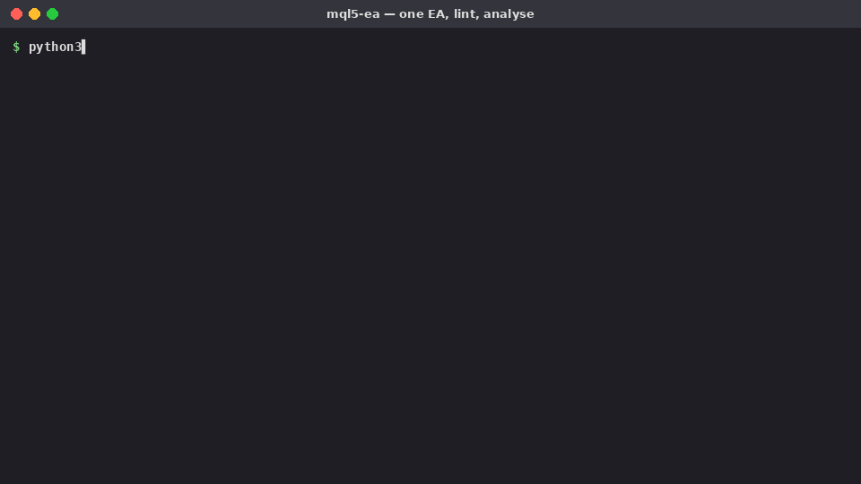

# mql5-ea — Claude Skill for MetaTrader 5 Expert Advisors



Generates safe MQL5 Expert Advisors from well-known strategy archetypes, reviews/ports existing code, and evaluates results — with the rules drawn from established EA and trading-system books (see [references/books.md](.claude/skills/mql5-ea/references/books.md); ideas are paraphrased, not copied).

| Task | How |
|---|---|
| New EA | `scripts/scaffold_ea.py` → complete `.mq5` with one of 4 strategies: `ma_cross` (trend + ADX), `donchian` (Turtle-style breakout), `bb_reversion` (Bollinger + RSI with trend filter), `session_breakout` (range breakout, one trade/day) |
| Safety core in every EA | Risk-% sizing from ATR stop (volume rounded down, skip below min lot), margin check, spread & time-window filters, daily loss limit, ATR trailing stop, magic-number isolation, closed-bar signals, retcode checks, handle release |
| Review / port MQL4 | `scripts/check_mq5.py` → MQL4 leftovers (`start()`, `OrderSelect(...MODE_TRADES)`, `Close[]`, `Ask`, 7-arg `iMA`…), handles created in `OnTick`, unchecked trades, missing stop loss, fixed lots, martingale |
| Evaluate results | `scripts/analyze_trades.py` → profit factor, win rate, payoff, expectancy ($ and R), SQN, max DD, recovery factor, losing streak + Monte Carlo (95th-pct DD, 5th-pct profit, P(ruin)) and red flags; optional Excel |
| Knowledge | `references/ea-patterns.md` (correct API use), `strategies.md` (archetypes, when they fail, anti-patterns), `risk-and-testing.md` (sizing, tester settings, walk-forward, incubation) |

```bash
python3 .claude/skills/mql5-ea/scripts/scaffold_ea.py TrendEA --strategy ma_cross --out MQL5/Experts
python3 .claude/skills/mql5-ea/scripts/check_mq5.py MQL5/Experts/TrendEA.mq5
python3 .claude/skills/mql5-ea/scripts/analyze_trades.py trades.csv --initial 10000 --risk 100 --xlsx report.xlsx
```
Examples of generated EAs: [`examples/`](examples).

## Installation
**claude.ai / Claude Desktop** — zip the `mql5-ea` folder (zip must contain `mql5-ea/SKILL.md`), Settings → Capabilities → Skills → Upload skill.

**Claude Code**
```bash
git clone https://github.com/panusbodee-owen/mql5-ea-skill.git
mkdir -p ~/.claude/skills && cp -r mql5-ea-skill/.claude/skills/mql5-ea ~/.claude/skills/
```
Python 3; `openpyxl` only for `--xlsx`.

## Status — read before trading
- Generated EAs were checked by the linter and for structure, but **not compiled here** (no MetaEditor in the build environment). Compile in MetaEditor (F7) and fix any compiler messages first.
- Demo GIF trade figures come from **synthetic** data, not a real strategy.
- No strategy here is profitable by default. Backtest with "Every tick based on real ticks", validate out-of-sample, Monte Carlo, then demo before live money. **Not financial advice.**
